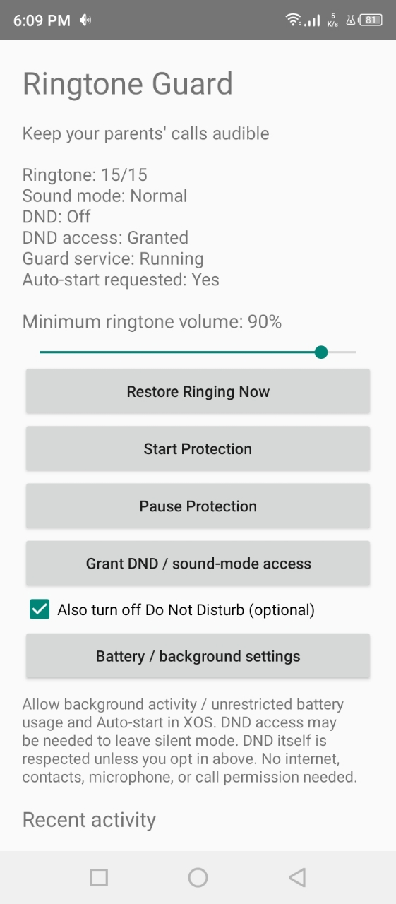

# Ringtone Guard

I built this because my parents kept missing my calls—not because they were ignoring me, but because their phones' ringtone volume had accidentally been turned down or muted. They didn't always notice, and I couldn't tell whether they simply hadn't heard the phone or something was wrong.

I'm a developer, so I wanted to build something small to help: an app that brings ringtone volume back to an audible level when it drops too low, and restores normal ringing from silent or vibrate where Android allows it. That's how **Ringtone Guard** started.

If you've had to remind a parent to turn their ringer back on, or you've missed important calls after accidentally silencing your own phone, this might be useful for you too. Choose a minimum volume, enable protection, and pause it whenever you actually want quiet. Turning off Do Not Disturb is a separate, optional choice—not the default.

It's a little less phone troubleshooting and, hopefully, fewer missed calls. It isn't an emergency-call guarantee: Android and manufacturer battery settings can interrupt protection, so test it on your phone before relying on it.

Built with native Android APIs. No third-party automation app, backend, or internet permission required; no Android Studio needed to build it.

## App preview

The Ringtone Guard screen lets you set a minimum ringtone volume, start or pause protection, and check the phone's current sound settings.

<p align="center">
  
</p>

## On the phone

1. Open **Ringtone Guard**.
2. Set **Minimum ringtone volume** (default 80%). This is a minimum, not a volume cap.
3. Tap **Restore Ringing Now** to make a one-time correction.
4. Tap **Grant DND / sound-mode access**, find Ringtone Guard, allow access, and return. Android can require this to leave silent mode. Granting access alone does **not** opt in to turning off DND.
5. Tap **Start Protection**, read the confirmation, then **Start**. Look for **Guard service: Running** and the persistent notification.
6. In **Battery / background settings**, allow background activity / unrestricted battery use. On Infinix/XOS, also allow Auto-start in the phone's app/power-management settings if present. Menu names vary.
7. Only if you want intentional DND undone too, check **Also turn off Do Not Disturb**. Otherwise DND is respected: audio corrections are suspended while DND is active, because Android sound-mode changes can implicitly switch DND off. Calls may still be silent.

**Pause Protection** (also available in the notification) stops corrections and disables boot auto-start. It leaves the current sound settings unchanged. Pause when quiet is needed.

## Test checklist

Use Android **Settings → Sound** to lower **ringtone** volume, not media or in-call volume. Hardware buttons often change media volume instead.

- **One-shot:** pause protection, lower ringtone volume, tap Restore Ringing Now. The ringtone level should rise to at least the selected minimum.
- **Automatic:** start protection, lower ringtone volume in Settings, wait up to about five seconds while awake. It should rise without reopening the app.
- **Silent / vibrate:** after granting DND access, select vibrate or silent. The guard should return to Normal. Verify the live status and call the phone.
- **DND respected:** leave the optional DND checkbox off, enable DND, and verify the guard does not deliberately switch it off. Calls can remain silent under DND.
- **Optional DND override:** enable the checkbox and then enable DND. Check it returns to Off. Disable the checkbox afterwards if you want DND respected.
- **Real call:** unplug USB, go home, lock the phone, and call it from another phone. Repeat after 15–30 minutes locked. Confirm it rings audibly, not just that a slider moved.
- **Restart:** with protection enabled, reboot and unlock once. Check the notification returns, then repeat the call and volume tests.
- **Pause:** pause protection and lower volume. It should stay lowered. Restore a suitable level afterwards.

Do not assume this is reliable enough for your parents until the locked/unplugged and reboot tests pass on **each** phone.

## Implementation and limitations

- Java, Android framework APIs only; minimum Android 8 (API 26), prototype target API 32. Device under development: Infinix X688B, Android 11 (API 30).
- Foreground service with a persistent notification; reacts to sound-mode/screen/DND events and checks every five seconds **while the CPU is awake**. The vendor-dependent volume-change broadcast is only a hint; periodic checks are the fallback.
- No permanent wake lock and no exact alarm. Deep sleep may delay checks, and XOS can kill background apps. This is not an absolute ringtone lock or an instant remote emergency override.
- Boot receiver resumes enabled protection after boot/unlock, subject to OEM restrictions. Android force-stop prevents auto-restart until the app is opened and protection started again.
- DND permission denial is handled; UI reports actual volume, sound mode, DND state, and service state. Recent corrections/errors are recorded locally.
- Ringtone and notification volumes may be linked by the phone. No media or in-call volume changes are requested.
- No ringtone file replacement: a silent ringtone, call routing, speaker fault, Bluetooth behavior, or network issue can still prevent audible calls.
- No remote backend, accessibility service, device-admin privileges, or root. No contacts, phone-call, microphone, storage, or internet permissions.
- This is a locally sideloaded debug build, not a Play Store release. Newer Android versions require target/foreground-service modernization before release; do not treat this as validated beyond the tested phone.

## Build / install from PowerShell

The local `.tools` folder contains JDK 17 and Android SDK command-line tools. They are project-local; the system PATH is not changed.

```powershell
powershell -ExecutionPolicy Bypass -File .\scripts\build.ps1
# Build, install on the single USB-connected device, and open:
powershell -ExecutionPolicy Bypass -File .\scripts\build.ps1 -Install
```

APK: `build/ringtone-guard-debug.apk`.

The script compiles Java with `javac`, converts bytecode using D8, packages using AAPT2, aligns and signs the APK, and verifies its signature. There are no Maven/Gradle dependencies. The debug signing key lives in `.tools/debug.keystore`; keep it to install updates without uninstalling. Do not use this debug key for a public release.

### Toolchain if recreating this folder

1. Download/extract a Windows x64 **JDK 17** into `.tools/java/<jdk-directory>` (Adoptium Temurin was used).
2. Download Google's **Android SDK command-line tools for Windows** into `.tools/android-sdk/cmdline-tools/latest` so it contains `bin/sdkmanager.bat`.
3. Set `$env:JAVA_HOME` to the JDK directory and add its `bin` to the current terminal PATH.
4. Run `sdkmanager.bat --sdk_root=<absolute-project-path>/.tools/android-sdk "platforms;android-32" "build-tools;34.0.0"` and review/accept Google's SDK licenses.
5. Keep Google's Windows Platform Tools in `platform-tools/` for installation.

## Project files

- `app/src/main/AndroidManifest.xml` — permissions/components.
- `app/src/main/java/com/family/ringtoneguard/` — activity, audio controls, foreground service, boot receiver.
- `scripts/build.ps1` — dependency-free local Android build.
